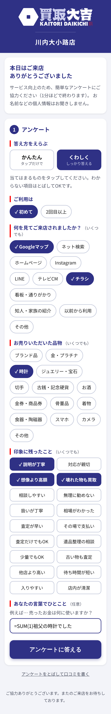

# 口コミ投稿サポートページ（買取大吉 川内大小路店）

来店されたお客様に、Googleマップへの口コミ投稿をお願いするためのスマホ向けページです。
店頭のQRコード・NFCカードからこのページを開いてもらいます。

## しくみ

1. お礼のあいさつを表示（全員に同じ画面。評価による振り分けはしない）
2. 「書くときのヒント」をタップすると書き出しが入る（お客様が自由に編集）
3. ボタンで文章をコピーし、Googleの口コミ投稿画面を開く

## 設定の変え方

`index.html` の下の方にある `CONFIG` だけを書き換えます。

| 項目 | 内容 |
|---|---|
| `storeName` | 店名 |
| `reviewUrl` | Googleビジネスプロフィールの「口コミを依頼」で取得したURL |
| `items` | 品物の選択肢 |
| `points` | 印象に残ったことの選択肢 |

## 画面の流れ

1. **アンケート**（来店経路・品物・印象に残ったこと など）→「アンケートに答える」
2. **Googleで口コミを書く**（アンケートから作った下書きを編集）→「Googleで口コミを書く」
3. Googleの口コミ投稿画面へ

アンケートの回答に関係なく、全員が同じ口コミ画面に進みます（評価による振り分けはしない）。
アンケートをとばして口コミへ進むこともできます。

## スプレッドシート連携

回答は Google Apps Script（`gas/Code.gs`）経由でスプレッドシートに記録されます。

1. 記録用のGoogleスプレッドシートを新規作成
2. [拡張機能] → [Apps Script] を開き、`gas/Code.gs` の中身をすべて貼り付けて保存
3. 関数 `testInsert` を選んで [実行]（初回は権限の承認が必要）→ シート「アンケート」にテスト行が入ればOK
4. [デプロイ] → [新しいデプロイ] → 種類「ウェブアプリ」
   - 次のユーザーとして実行：**自分** ／ アクセスできるユーザー：**全員**
5. 表示された「ウェブアプリのURL」を `index.html` の `CONFIG.sheetUrl` に貼る

記録される列：日時 / ID / 答え方 / ご利用 / 来店経路 / 品物 / 印象に残ったこと / あなたの言葉 / 下書きの文章 / Googleへ進んだ / コピーした文章

- 個人情報（名前・連絡先）は集めていない
- URLはページに書かれるため誰でも見られる。いたずら対策として、ID形式のチェック・文字数制限・数式の無害化をしている
- `Code.gs` を直したら [デプロイ] → [デプロイを管理] → 編集 → バージョン「新バージョン」で更新（URLは変わらない）

## 公開

GitHub Pages（Settings → Pages → Branch: `main` / `/ (root)`）で公開しています。

## デザイン（買取大吉VIガイドライン準拠）

- ロゴ: `assets/logo_h_blue.png`（青ベース・ヨコ組み。色・形の加工禁止、サイズ変更のみ可）
- ロゴ周りに高さの25%以上の余白、印刷物ではヨコ組みロゴの高さ12mm以上
- 色: ブルー / レッド / ラベンダー（コーポレートカラー）、書体: 源ノ角ゴシック（Noto Sans JP）
- ロゴ使用は本部の使用許諾に基づく（許諾期間1年。継続時は再申請）

## 運用上の注意（Googleの規約・ステマ規制）

- 満足したお客様だけに投稿をお願いする「選別」はしない
- 投稿の見返り（割引・粗品など）は渡さない
- 本文はお客様自身の言葉で。店が文面を指定・代筆しない
- 同じ文章が並ばないよう、言い回しは開くたびにランダム（「ひとこと」「くわしく」の2モード）
- 投稿はお客様ご自身のスマホ・アカウントで。店のタブレットや店のWi-Fiでまとめて投稿してもらわない
- 一度に大量に依頼しない（毎日少しずつ、自然なペースで）
